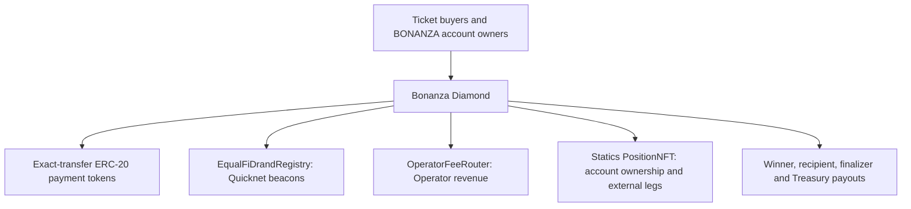

# Bonanza

Bonanza is an ERC-20 lottery protocol with configurable rounds, drand Quicknet
randomness, and token rewards. The protocol and ERC-20 name are **Bonanza**;
the token symbol is **BONANZA**.

Each round snapshots its payment token, economics, and integrations. The first
purchase opens the round. Sales end at sellout or the configured deadline, and
the committed future beacon selects a winner from the tickets sold. Settlement
records liabilities; winners and revenue recipients collect through separate,
retryable payout paths. Current rounds have no cancellation or refund path.

This repository contains the contracts, tests, specifications, and development
tooling. The [release checkpoint](docs/release-checkpoint.md) distinguishes the
current fresh-deployment candidate from historical testnet records.

## How it fits together



The single Diamond address routes calls to Lottery and BONANZA facets. BONANZA
is backed one-for-one by STATICS in token base units. Reserve funding mints backed
reward inventory; participation distributes that inventory without creating new
backing or debt. BONANZA account custody, staking, and accrued staker revenue
follow the owning Statics PositionNFT. Ticket ownership remains wallet-based.
Ordinary BONANZA transfers are restricted to approved-consumer paths, and public
wrap and unwrap start disabled.

The protocol supports concurrent rounds and keeps custody and liabilities
separate by payment token. Native ETH is not a ticket payment asset. Governance
controls future configurations and integrations, consumer permissions, and
optional features. Diamond upgrades remain possible until irreversible code
finalization; configuration governance and two-step authority handover remain afterward. The deployment must
supply the intended external governance delay. See the
[governance model](docs/governance.md) and [token policy](docs/payment-token-policy.md).

## Build and test

Use Git, Python 3, and Foundry **v1.8.1**, matching CI. The primary contracts use
Solidity **0.8.30**, optimizer **200 runs**, and the **Osaka** EVM target. The pinned
Statics integration builds separately with its own compiler configuration.

```sh
git clone --recurse-submodules https://github.com/EqualFiLabs/bonanza.git
cd bonanza
# For an existing clone:
git submodule update --init --recursive

forge build --config-path integration/foundry.toml
forge build
python3 script/check-statics-abi.py
forge test
```

The independent Statics build produces artifacts consumed by integration tests,
so run it before the main test suite. Dependency revisions are pinned by Git
submodules; changing them changes the candidate being tested.

Useful focused checks:

```sh
forge fmt --check
forge fmt --root integration --check
forge lint
forge test --match-path 'test/Bonanza*.t.sol'
FOUNDRY_PROFILE=ci forge test -vvv
```

[CI](https://github.com/EqualFiLabs/bonanza/actions/workflows/ci.yml) runs builds,
formatting, ABI parity, lint, unit/fuzz/invariant tests, Slither, and fork-runner
safety checks. The fork qualification test skips when its RPC environment is
absent; a passing ordinary test run does not establish fork qualification.
Fork execution is described separately in the
[local rehearsal guide](script/mainnet-rehearsal/README.md). No deployment or
live transaction is needed for the ordinary build and test commands above.
Before a fresh deployment, use the read-only
[dependency preflight](script/deployment-preflight/README.md) with a reviewed
target-chain manifest. It does not replace post-deployment verification.

## Documentation

| Read | Contents |
|---|---|
| [Architecture](docs/architecture.md) | Facets, storage, lifecycle, custody, and external boundaries |
| [Accounting](docs/accounting.md) | Allocation, liabilities, reserves, claims, and token isolation |
| [BONANZA rewards](docs/bonanza-rewards.md) | Backing, inventory, PositionNFT accounts, staking, and boosts |
| [Randomness](docs/randomness.md) | Beacon commitment, settlement, and chain assumptions |
| [Governance](docs/governance.md) | Authority, guardian, pause, upgrades, and code finalization |
| [Payment token policy](docs/payment-token-policy.md) | Exact-transfer requirements and admission assumptions |
| [Operator routing](docs/operator-router-integration.md) | Integration versions and retryable revenue delivery |
| [Release checkpoint](docs/release-checkpoint.md) | Current candidate and historical evidence boundaries |
| [Deployment index](deployments/README.md) | Historical manifests and testnet provenance |
| [Verification summary](formal/README.md) | Historical proof coverage and its limitations |

The normative specification set is [requirements](specs/requirements.md),
[design](specs/design.md), and [implementation tasks](specs/tasks.md).

## Repository map

| Directory | Purpose |
|---|---|
| `src/` | Diamond, facets, initializer, interfaces, libraries, and shared types |
| `test/` | Unit, integration, adversarial, fuzz, and invariant tests |
| `integration/` | Independently compiled Statics fixtures |
| `script/` | Deployment tooling, historical validators, and local fork rehearsal |
| `docs/` | Protocol guides and release context |
| `specs/` | Normative behavior and design |
| `deployments/` | Network-specific historical deployment records |
| `lib/` | Pinned external dependencies |
| `tooling/` | Isolated testnet Router utilities |
| `formal/` | Public verification summary; execution artifacts are kept privately |

See [contribution guidance](CONTRIBUTING.md) before proposing changes. Source files
retain their existing SPDX license identifiers; dependency licenses remain with
their respective projects.
